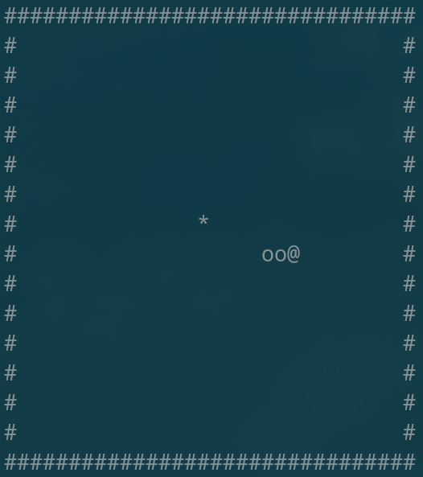

# snake

A terminal Snake game, built as a **1010-byte** Linux x86-64 executable made of raw machine code. No compiler, assembler or libc went into it, only Linux system calls.

```
./snake
```

Controls: **WASD** or the **arrow keys** to steer, **Q** (or Ctrl-C) to quit.



## How it was made

Every x86-64 instruction is written by hand as hex bytes in `build.py`. That includes the ELF header and program header, the 64 + 56 bytes that tell Linux how to load the file.

The one shortcut: the Python script works out jump distances and string addresses, so nobody had to count bytes by hand. It doesn't generate any instructions itself.

To rebuild:

```
python3 build.py
```

## How it works

- **Terminal input:** the program switches the terminal into raw, non-blocking mode itself (via `ioctl`), so each keypress arrives immediately. It restores the normal mode on exit.
- **Snake body:** each cell of the 30×14 grid stores how many turns it has left to live. Every tick, all body cells count down by one, and the new head cell gets the snake's length. When the snake eats, the countdown is skipped for one tick, which makes it one segment longer. This means the program doesn't need a list of body positions.
- **Food:** placed with a small xorshift random-number generator, seeded from the CPU's cycle counter (`rdtsc`).
- **Drawing:** each frame is written to a buffer and sent to the terminal in a single `write`.

## What was tested

It was run in a pseudo-terminal with simulated keypresses and a simple bot steering toward the food:

- WASD and the arrow keys both steer the snake.
- Eating food raises the score and makes the snake longer.
- Hitting a wall or the snake's own body prints "GAME OVER!".
- Q and Ctrl-C quit cleanly, the cursor and terminal settings come back, and the exit code is 0.

## Files

| File | What it is |
|------|------------|
| `build.py` | The hand-written machine code, with a comment on each instruction. |
| `snake.hex` | The whole binary as hex text. |

You can build the binary from `snake.hex` without Python:

```
xxd -r -p snake.hex > snake && chmod +x snake
```
